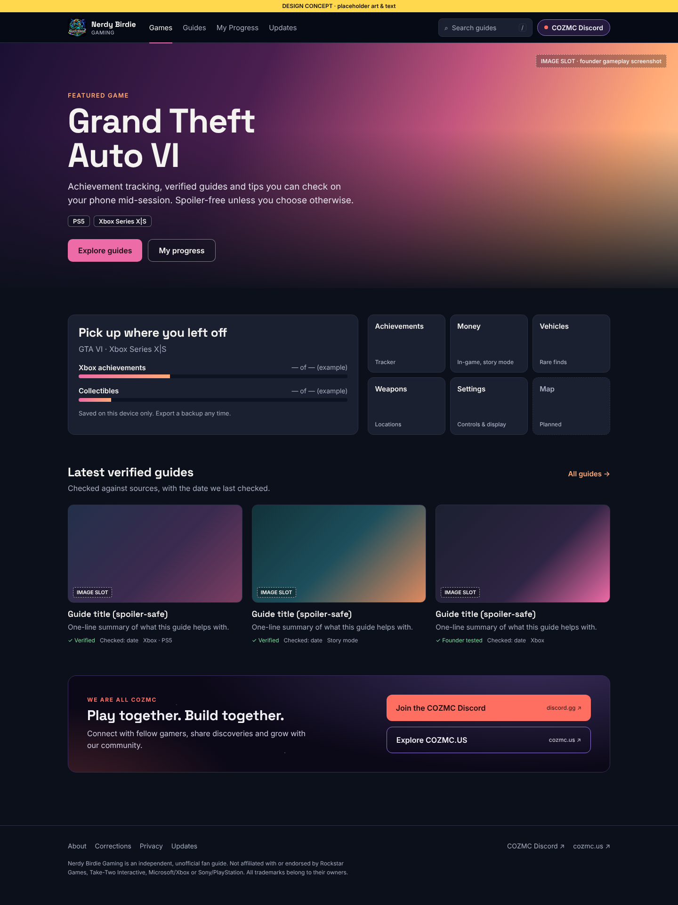
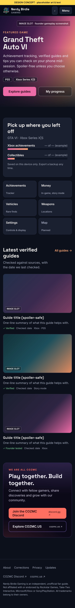
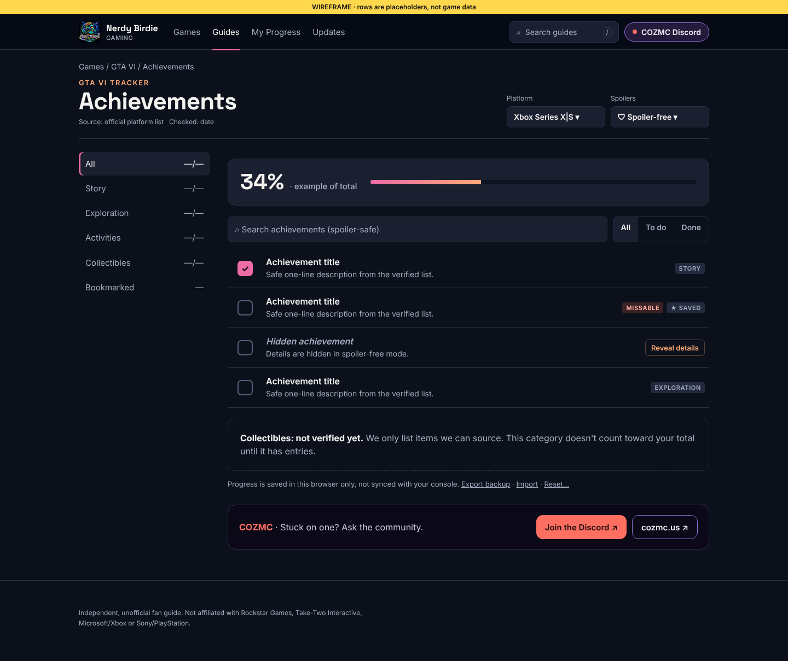
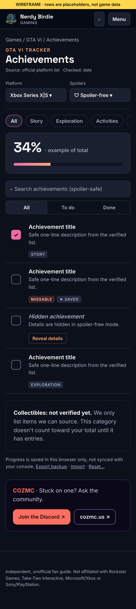

# Phase 0 plan: Nerdy Birdie Gaming

Status: **waiting for founder approval** · Written 2026-11-24 · No site code has been written yet.

This is the report the kickoff prompt asks for. Section 8 lists everything I need from you, so you can approve once.

---

## 1. Understanding and constraints

**What we're building:** a free, independent companion site for GTA VI that grows to more games later. People use it on their phone next to the console, so it has to answer a question in seconds. It sends players to the COZMC Discord and cozmc.us without forcing anyone to join.

**What I checked:**
- **Workspace:** this is `CosmicMorpheus/nerdybirdie-gaming`, a new repo with one commit (your starter pack, unchanged). It is **not** the cozmc repo, and nothing here touches cozmc.us.
- **Tools available:** Node 22.23.5, npm 10.9.9, pnpm 10.28, and Playwright with Chromium, so I can render and screenshot real pages. I also have web search.
- **Not available:** your Xbox, any official media licences, a domain, Netlify access for a new site.

**Hard limits for the first version (from `CLAUDE.md`):** no accounts, wallets, payments, tokens or blockchain. No Discord gate. Spoiler-free by default. No invented game facts or links. Nothing gets deployed or published without your approval.

**Where COZMC details come from:** the Discord invite `https://discord.gg/UUyC6aw9W` is in the cozmc repo's `src/config.ts`, which counts as authorised existing context. `https://cozmc.us/` is approved in the spec.

## 2. Proposed stack and tradeoffs

| Piece | Choice | Why |
|---|---|---|
| Site framework | **Astro 7** (7.4.13 is current on npm; it needs Node ≥ 22.23.4) | Builds plain HTML pages that Google can index and that load fast on phones. JavaScript is added only where a page needs it. |
| Interactive parts | **Preact islands** (tracker, search, spoiler and platform switches) | Uses the same JSX you write in cozmc, at about a tenth of React's size. Swapping to React later is a config change. |
| Language | TypeScript, strict mode | |
| Content | JSON files in `content/`, checked against **Zod schemas** at build time | A bad ID, a broken reference or a draft entry fails the build instead of reaching the site. |
| Tests | **Vitest** for the progress and spoiler logic; **Playwright + axe** for browser flows and accessibility | |
| Fonts | Space Grotesk and Inter, **self-hosted** | Avoids sending every visitor's IP address to Google Fonts. |
| Hosting | A **new Netlify site** with its own `netlify.toml`, on a password-protected staging URL first | Same host as cozmc, but a separate site. |

**Alternatives I considered:**
- **Plain HTML/CSS/JS** (the original brief's default): no build step, but every page would repeat its header and footer by hand, and there's no content validation. It gets harder to manage once there are 30+ guide pages.
- **Vite + React single-page app, like cozmc:** familiar, but its `#/` routes don't work as separate search results, which a guide site depends on.

I'll pin exact versions in a lockfile and re-check each package's docs when setting it up.

## 3. Sitemap and folder structure

```
/                                   Home
/games/                             Game library (just GTA VI at first)
/games/gta-vi/                      Game overview + platform picker
/games/gta-vi/achievements/         Tracker (platform switch: Xbox achievements / PS5 trophies)
/games/gta-vi/guides/               Guide index by category
/games/gta-vi/guides/<slug>/        One guide
/progress/                          My progress across games, plus backup/restore
/updates/                           What changed and when
/about/  /corrections/  /privacy/   Required pages (unofficial disclaimer goes on About)
/404
```

Only approved, published pages go into `sitemap.xml`. The staging site gets `noindex` and a password.

```
src/
  components/      Header, Footer, CozmcPanel, GuideCard, ProgressBar, SpoilerGate, VideoEmbed, SourceList…
  islands/         Tracker.tsx, Search.tsx, SpoilerSwitch.tsx, PlatformSwitch.tsx
  layouts/         Base.astro, Game.astro (sets the Vice City theme), Guide.astro
  pages/           the routes above
  lib/             progress/ (store, migrate, export/import), spoilers/, content/ (schemas, loaders)
  styles/          tokens.css (three colour layers), base.css
  config.ts        site URL, COZMC links, parent site (empty until you supply it)
content/
  platforms.json
  games/gta-vi/    game.json, objectives/*.json, guides/*.json, sources.json, media.json, videos.json
  fixtures/        test-only data, never included in a public build
public/media/      optimised images (originals kept out of the repo)
tests/             unit/, e2e/
docs/              specs, this plan, DECISIONS.md, wireframes/
assets/brand/      original logo (never modified)
```

## 4. Visual direction (rendered wireframes)

These are real renders from Playwright, at 1440px and 390px wide. They use the spec's colour tokens and fonts. **All images are labelled placeholders and all text is placeholder text.** No game art and no game data. Source: `docs/wireframes/*.html`.

| Home, desktop | Home, phone |
|---|---|
|  |  |

| Tracker, desktop | Tracker, phone |
|---|---|
|  |  |

**How it's laid out:**
- **Three colour layers kept apart:** Nerdy Birdie colours only on the brand mark; Vice City pink/sunset on the game pages; COZMC deep-space purple and Living Coral only inside its own panels, so the community module is clearly its own thing.
- **COZMC links appear in five places:** the header pill (desktop), the mobile menu, the home page panel, an inline panel on guides and the tracker, and the footer. Discord and cozmc.us are always two separate buttons. No pop-ups.
- **Phone-first tracker:** checkboxes have targets of 44px or more, categories become a swipeable row, the spoiler setting stays visible, and export/import/reset sit in quiet secondary links. The hero image slot is sized so your Xbox screenshots can drop straight in.
- **Checks done on these wireframes:** no sideways scroll at 390px or 1440px (measured). I found and fixed an 81px overflow on the phone tracker. Not checked yet: 320px, 768px, 1024px, 200% zoom, contrast measurements. Those come in Phase 1 on the real pages.

**Logo issue:** the logo is detailed square art (1254×1254). At header size (32–40px) the "NERDY BIRDIE" lettering can't be read and the art turns into a blur (see the top-left of the renders). The spec forbids cropping it without your approval. Two options:
- **(a)** Keep the full logo small next to the typed name "Nerdy Birdie Gaming". This is what the wireframes show, and it's safe.
- **(b)** Approve a cropped **mascot head** version just for the header and favicon. It reads much better at small sizes. The original stays untouched, and the full logo still appears large on About and in the footer.

## 5. Data model and spoiler approach

The data model follows `docs/04`'s recommended schema, with these key points:

- **Objective:** stable ID namespaced by game (`gta-vi:xbox:ach-001`), `kind` (official achievement / trophy / in-game completion / optional challenge), `platformIds`, `safeTitle`, `safeSummary`, `protectedDetails`, `spoilerLevel` (none / minor / major), `missable` (true / false / unknown), `sourceIds`, `verificationStatus`, `publicationStatus`, `revision`. Xbox and PlayStation lists stay separate. If an objective is shared between them, that's written down explicitly, never assumed.
- **Progress** (browser storage key `nbg:progress`):
  `{ schemaVersion, contexts: { "gta-vi|xbox-series": { completed: {id: timestamp}, bookmarks, notes }, … }, prefs: { spoilerMode, platformByGame }, updatedAt }`.
  Each game-and-platform pair has its own progress. Migrations change the schema version without touching IDs. If an entry is retired, its ID is kept so nobody's ticks disappear.
- **Totals:** an empty category shows as "not verified yet" and never as 100%. Hidden objectives count toward the total without revealing anything.
- **Backup:** export downloads a JSON file. Import checks the file, shows a preview ("adds 12, changes 3"), and only then writes. If import fails, existing data is left alone. If browser storage is blocked or full, the site says so and explains how to recover.

**Spoilers:**
- **Three modes:** spoiler-free (the default), minor, and all. The setting is remembered.
- **Spoiler text never goes into the page or its search data.** Built pages, page titles, social previews, URLs, alt text and the search index contain only the safe fields. Protected details live in a separate per-game file, loaded only after you tap **Reveal** (or when your mode allows it).
- **Search** indexes only safe titles, summaries and categories, so autocomplete can't leak anything.
- **Achievement names can themselves be spoilers.** For story or hidden ones, the safe title is a neutral label like "Story achievement · Chapter-gated" until revealed.
- **Honest limit:** this hides things for the reader's experience. Someone determined can still read the files directly. It's not a security lock.

## 6. Vertical slices and definition of done

**Phase 1** (the first slice the kickoff asks for), in order:

1. **Scaffold + site shell:** Astro, tokens, header/footer, mobile menu, COZMC panel, About/Privacy/Corrections pages.
2. **Content system:** schemas, validation, and a build that fails on bad data. Test fixtures are kept out of public builds.
3. **Progress engine:** the store, migrations, totals and export/import, with unit tests written first.
4. **Tracker page:** platform switch, categories, filters, search, bookmarks, notes, and reset with confirmation.
5. **Spoiler engine + safe search:** reveal-on-demand, plus tests that check for leaks in HTML, search data and metadata.
6. **Content:** the official Xbox achievement list, researched and cited, marked **draft until you review it**. If it can't be verified, the tracker shows honest empty states.
7. **QA pass:** screenshots at 320/390/768/1024/1440px and 200% zoom, an axe accessibility scan, keyboard-only use, and simulated storage failures. Then a milestone report using `templates/Milestone_Report.md`.

**Phase 1 is done when:** every row of the acceptance table in `docs/05` that applies to this slice has evidence (commands run and their real output, plus screenshots), with anything skipped stated plainly. It runs locally and on a staging branch. Deploying to a live staging URL needs your approval.

**Phase 2** (after you've played with it): PS5 trophies, money/vehicles/weapons/settings guides, click-to-load YouTube, your screenshots, sitemap/SEO, and launch checks.

## 7. Risks, rights and verification

| Risk | Plan |
|---|---|
| **GTA VI facts** | Public reports say it released **19 November 2026 on PS5 and Xbox Series X\|S**, with no PC version announced ([Forbes](https://www.forbes.com/sites/brianmazique/2026/05/12/grand-theft-auto-6-release-date-and-everything-confirmed/), [Red Bull](https://www.redbull.com/int-en/gta-6-release-guide), [Tom's Guide](https://www.tomsguide.com/us/grand-theft-auto-6-release-date-rumors,news-25578.html)). The wireframes show those two platforms. Before launch I'll confirm against Rockstar's, Xbox's and PlayStation's own pages and record that in the source register. |
| **Achievement list accuracy** | Taken only from official platform listings, cross-checked with at least one established guide site, and logged in `Source_and_Asset_Register.csv`. Descriptions are reworded, not copied. Nothing shows as "verified" until you approve it. |
| **Game images** | No Rockstar art without permission. The hero and guide images use labelled placeholders until your screenshots arrive. I'll read Rockstar's fan-content policy before publishing any gameplay captures, and the media pipeline strips gamertags and other account details. |
| **Trademarks** | Use the game's name only to say what the guide covers. No Rockstar logos or look-alike UI. Disclaimer on every page footer and on About. Avoid "GTA" in the domain name. |
| **Spoilers leaking** | Automated tests search the built HTML, search data and metadata for protected text. External videos get a neutral warning before you leave the page. |
| **Fake or broken links** | Links come from one place (`src/config.ts`) and a link check runs before release. The parent Nerdy Birdie link stays hidden until you give me the URL. |
| **Lost progress** | Prominent backup export, a clear "this device only" notice, and import that never overwrites on failure. |
| **Research limits** | I have web search but no logged-in console access. Anything I can't verify is marked as such rather than guessed. |

## 8. Founder decisions: one approval

Reply **"approved"** to accept every recommended choice below, or name only the ones you'd change.

| # | Decision | My recommendation |
|---|---|---|
| A | Stack | Astro 7 + TypeScript + Preact islands, on Netlify |
| B | Phase 1 scope | Slices 1–7 above, Xbox achievements first (you play on Xbox), PS5 trophies in Phase 2 |
| C | Discord invite | Use `https://discord.gg/UUyC6aw9W` from cozmc. **Please confirm it's set to never expire.** |
| D | COZMC assets | Reuse the cozmc logo files from the cozmc repo (`public/assets/cozmc-logo-*.png`) in the COZMC panel |
| E | Header logo | Option (a) for now (full logo + typed name). Tell me if you want me to mock up option (b), the mascot crop. |
| F | Achievement content | I research the official Xbox list and add it as draft; you review before it's marked verified |
| G | Tagline | Show "Play Smarter. Discover More." on staging only, marked as proposed |
| H | Analytics | None in Phase 1. Propose a privacy-friendly option later. |
| I | Repo visibility | Make it **private** until launch (GitHub settings; currently public) |
| J | Domain | Not needed yet. Decide before Phase 2 launch (own domain vs `gaming.cozmc.us`). |

Not needed now: the parent Nerdy Birdie site URL, monetisation details, final domain.
